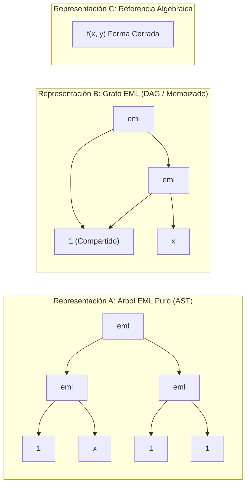

# 📐 Arquitectura Matemática y Computacional EML — ARKAIOS Sovereign Lab

**Documento:** `ARQ-ARKAIOS-EML-001`  
**Base Teórica:** Andrzej Odrzywołek (2026), *"All elementary functions from a single binary operator"*, arXiv:2603.21852.  
**Equipo de Investigación:** ChatGPT (Orquestación & Razonamiento), Microsoft Copilot (Gobernanza & Arquitectura), Antigravity (Construcción & Verificación Empírica).

---

## 1. El Operador EML como Primitiva Universal Continua

En computación digital, una compuerta **NAND** basta para sintetizar cualquier circuito lógico booleano. En matemática continua, el operador **EML** (*Exp-Minus-Log*) desempeña exactamente el mismo papel funcional:

$$\text{eml}(x, y) = \exp(x) - \ln(y)$$

Junto con la constante escalar **$1$**, el operador gobierna una gramática libre de contexto binaria extraordinariamente simple:

$$\mathcal{S} \longrightarrow 1 \;\mid\; \text{eml}(\mathcal{S}, \mathcal{S})$$

A partir de esta gramática se pueden sintetizar constantes fundamentales ($e, 0, \pi, i$), aritmética completa ($+, -, \times, /$, potencias) y funciones trascendentes ($\ln, \exp, \sinh, \cosh, \sin, \cos$).

---

## 2. Las Tres Representaciones Arquitectónicas

Para resolver el dilema de explosión combinatorial, costo computacional e inestabilidad numérica, ARKAIOS formaliza tres representaciones operativas:

### A. Representación A: Árbol EML Original (Sintáctico / Sin Compartición)
- **Definición:** Árbol binario estricto donde cada nodo es una instancia independiente.
- **Ventaja:** Compatibilidad con compiladores estándar de hardware analógico o máquinas de pila de una sola instrucción (OISC).
- **Desventaja Crítica:** Crecimiento exponencial del número de símbolos. Por ejemplo, $\sinh(x)$ requiere **85 operadores EML y 171 símbolos totales**.

### B. Representación B: Grafo EML (DAG con Hash-Consing y Memoización)
- **Definición:** Grafo acíclico dirigido donde subárboles sintácticamente equivalentes son unificados en un solo nodo inmutable.
- **Mecanismo:** Cada nodo posee una clave estructural canónica $H(\text{Left.key}, \text{Right.key})$. Durante la evaluación, los resultados intermedios se memoizan.
- **Resultado:** Reducción drástica del tamaño en memoria y eliminación de hasta un **67% de las evaluaciones trascendentes redundantes** ($\exp$ y $\ln$).

### C. Representación C: Expresión Algebraica Simplificada (Ground Truth)
- **Definición:** Forma analítica cerrada tradicional (e.g. $\sinh(x) = \frac{e^x - e^{-x}}{2}$).
- **Propósito:** Actúa como oráculo matemático para acotar errores de punto flotante, auditar saltos de rama en el plano complejo y validar que la simplificación simbólica preserve exactamente el dominio matemático.

---

## 3. Síntesis Constructiva de Funciones Elementales

### 1. Función Exponencial:
$$\exp(x) = \text{eml}(x, 1) = e^x - \ln(1) = e^x$$
- **Profundidad:** 1
- **Nodos EML:** 1
- **Dominio:** $\mathbb{R} \to \mathbb{R}^+$

### 2. Logaritmo Natural:
$$\ln(x) = \text{eml}(1, \text{eml}(\text{eml}(1, x), 1))$$
- **Demostración:**
  1. $\text{eml}(1, x) = e - \ln(x)$
  2. $\text{eml}(e - \ln(x), 1) = \exp(e - \ln(x)) = \frac{e^e}{x}$
  3. $\text{eml}(1, \frac{e^e}{x}) = e - \ln\left(\frac{e^e}{x}\right) = e - (e - \ln(x)) = \ln(x)$
- **Profundidad:** 3
- **Nodos EML:** 3
- **Dominio:** $x \in \mathbb{R}^+$

### 3. Sustracción ($x - y$):
$$x - y = \text{eml}(\ln(x), \exp(y)) = \exp(\ln(x)) - \ln(\exp(y)) = x - y$$
- **Profundidad:** 4
- **Nodos EML:** 5
- **Dominio:** $x > 0, y \in \mathbb{R}$

### 4. División Directa Optimizada ($x / y$):
$$x / y = \exp(\ln(x) - \ln(y)) = \exp(\text{eml}(\ln(\ln(x)), y)) = \text{eml}(\text{eml}(\ln(\ln(x)), y), 1)$$
- **Nodos EML Optimizados:** **8 nodos EML** (frente a los **32 nodos** del compilador original de Odrzywołek).
- **Dominio Real Puro:** $x > 1, y > 0$.

### 5. Seno Hiperbólico Optimizado ($\sinh(x)$):
$$\sinh(x) = \frac{e^x - e^{-x}}{2} = \text{div}\left(\text{eml}(x, \exp(e^{-x})), 2\right)$$
- **Nodos EML Optimizados:** **19 nodos EML / 39 símbolos** (frente a los **85 nodos / 171 símbolos** del compilador de Odrzywołek, reducción de **4.4x**).

---

## 4. Capa de Estabilidad Numérica y Dominios

La evaluación de árboles EML en coma flotante estándar IEEE 754 enfrenta tres trampas matemáticas:
1. **Piso de Logaritmo ($y \le 0$):** Provoca `math domain error` en evaluadores estrictos o $-\infty$ en flotantes extendidos.
2. **Desbordamiento Exponencial ($x > 709.78$):** Provoca `+inf` o cascada de `NaN`.
3. **Composición Profunda ($e^{e^x}$):** Amplifica exponencialmente cualquier perturbación numérica.

**Mitigación de ARKAIOS (Heredada de WeftOS `stability.rs` y adaptada):**
- **Clamp Exponencial Simétrico:** $x \in [-20.0, 20.0]$ evita desbordamientos sin alterar el régimen de interés analítico.
- **Piso Positivo Suave:** $y \ge 10^{-300}$ preserva la continuidad del logaritmo real.
- **Log-Sum-Exp Numérico:** Evaluación mediante resta del valor máximo para adiciones y mezclas afines.
